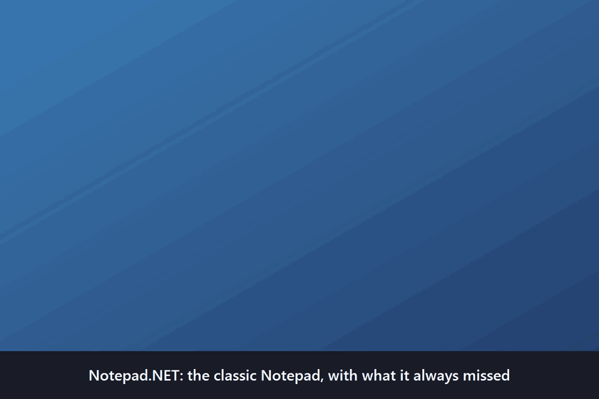

# Notepad.NET

The classic Windows Notepad, with the few things it always missed. Same menus, same keys, same plain Edit control,
and your unsaved text no longer depends on a dialog.



## What it adds to the original

| Feature | What it does |
|---|---|
| **Unsaved notes** | Closing a window asks nothing. The text stays on disk and comes back on the next start, and a crash or power cut loses only the last seconds |
| **Discard Changes** | File > Discard Changes puts a file back to what is on disk and an untitled note back to an empty page; Ctrl+Z undoes it until the window closes |
| **Changes from other programs** | The window tells you right away when another program changes or deletes the open file and offers to reload it, and Save asks before writing over that change |
| **Recent Files** | File > Recent Files reopens the last 10 files |
| **File path commands** | File > Copy Full Path and File > Open Containing Folder |
| **Always on Top** | View > Always on Top |
| **Transparency** | View > Transparency, or Ctrl+Shift+Wheel |

Everything else follows the original (`notepad.exe` 10.0.26100.8457): this is a C# WinForms (.NET 10) reimplementation
written from a study of its behavior and checked against it running side by side. No Microsoft code, icons or binary
resources are copied; behavior is ported, not code. `docs/parity.md` lists every behavior, where the port implements
it, its tests, and whether the port matches the original or differs on purpose. One cost is measured in
`docs/performance.md`: the window appears in about 170 ms, against about 30 ms for the original.

## Download

Get it from [Releases](https://github.com/nccnm/Notepad.NET/releases). Nothing is code-signed, so SmartScreen may warn
on the first run.

- **Setup** (`Notepad.NET-<version>-setup-x64.exe` or `-arm64.exe`): installs for the current user, without
  administrator rights, and adds a Start menu entry and an Open with entry for `.txt` files. It can also make the
  `notepad` command open Notepad.NET in PowerShell, cmd and Win+R: tick that box in the setup; removing the app, or
  running the setup again without the box, puts back what was there. See `docs/installer.md`.
- **Zip**: unzip anywhere and run `Notepad.NET.exe`. `win-x64` and `win-arm64` need nothing else; the smaller
  `win-x64-framework-dependent` needs the .NET 10 Desktop Runtime. The `notepad` command still opens the Notepad of
  Windows.

To publish a release, push a tag: `git tag v1.0.0` then `git push origin v1.0.0`. The `Release` workflow runs the
tests, builds the three single-file variants and the two setups, and creates the GitHub release (a tag with a suffix such as
`v1.0.0-rc.1` makes a prerelease).

## Layout

| Path | Contents |
|---|---|
| `src/NotepadNet.Core` | Pure .NET: encoding rules, document logic, search, printing layout, command line, settings model. No WinForms, no P/Invoke (enforced by `BannedSymbols.txt`) |
| `src/NotepadNet.Platform` | Win32 implementations of the Core interfaces (`LibraryImport`, COM file dialogs) |
| `src/NotepadNet.App` | WinForms shell `Notepad.NET.exe`: main window, USER32 Edit control host, menus, two-tier keys, status bar |
| `tests/NotepadNet.Core.Tests` | Unit tests, coverage gate 90% line and branch |
| `tests/NotepadNet.Platform.Tests` | Integration tests against real Win32 APIs, golden files in `TestData/` |
| `tests/NotepadNet.App.Tests` | Shell tests on an STA thread with the real Edit control and fake dialogs |
| `tests/NotepadNet.E2E.Tests` | FlaUI (UIA3) end-to-end tests on the built exe with a temporary settings hive and autosave folder |
| `tests/NotepadNet.ParityProbes` | Console tool, not run in CI: re-checks observations of the original Notepad (saves and restores its registry key) |
| `bench/NotepadNet.Benchmarks` | BenchmarkDotNet over the hot paths (load, find, replace all, save) |
| `bench/NotepadNet.PerfHarness` | Out-of-process startup, load and Find timings, same method for the port and the original |
| `assets/icon.svg` | Source of the app icon (drawn for this project) |
| `docs/parity.md` | Every documented behavior of the original, where it is implemented, its test, and whether the port matches |
| `docs/performance.md` | Budgets, measurements and how to repeat them |
| `docs/installer.md` | What the setup changes on a machine, how it is built and tested |
| `installer/` | Inno Setup script of the setup, the script behind the `notepad` command, and their build and test scripts |
| `docs/local-install.md` | How the release build is installed as the `notepad` command (PowerShell, cmd, Win+R) on the development machine, and how to undo it |
| `tools/` | Scripts that regenerate test data and `app.ico` (`New-AppIcon.ps1`, `IconGen/`) |

## Build and test

```
dotnet build NotepadNet.slnx -c Release
dotnet test --solution NotepadNet.slnx -c Release
```

The end-to-end tests drive the real window with the keyboard for about a minute; leave the desktop alone while
they run, or skip them with `dotnet test --project` on the other test projects.

Core coverage with the CI gate:

```
dotnet test --project tests/NotepadNet.Core.Tests -c Release -- --coverlet --coverlet-include "[NotepadNet.Core]*" --coverlet-threshold 90 --coverlet-threshold-type line,branch --coverlet-threshold-stat Total
```

Run the app: `dotnet run --project src/NotepadNet.App -c Release`. For a release build with
ReadyToRun code (faster startup): `dotnet publish src/NotepadNet.App -c Release -r win-x64`.
To make `notepad` open the port, see `docs/local-install.md`.
Setting `NOTEPADNET_STARTUP_TRACE` to a file path makes the app append a startup timeline
(milliseconds since process start per step, JIT counters) to that file; see `docs/performance.md`.

Settings live in `HKCU\Software\Notepad.NET` (machine-wide default font in
`HKLM\Software\Notepad.NET\DefaultFonts`). On the first run, valid values of the original's
`HKCU\Software\Microsoft\Notepad` are copied once; that key is never written. Setting
`NOTEPADNET_SETTINGS_HIVE` to a file path makes the app keep every settings key in that
application hive instead (end-to-end tests use it).

The app was called Notepad Classic up to v1.0.0. The first run under the new name moves the notes of
`%LOCALAPPDATA%\NotepadClassic\Autosave` and copies the values of `HKCU\Software\NotepadClassic`, which stays for the
old version and can be deleted by hand.

Closing a window with unsaved text asks nothing: like the newer Windows 11 Notepad, the text stays in
`%LOCALAPPDATA%\Notepad.NET\Autosave` (`<id>.json` manifest and `<id>.txt` raw UTF-16 LE, not encrypted) and the
next start without arguments brings it back, one window per note; File > New Window and opening a file leave it
waiting. To drop a note, use File > Discard Changes: a file goes back to what is on disk and an untitled note to an
empty page, and Ctrl+Z brings the text back until the window closes. While the app runs the same files are updated within
3 seconds of a change, so a crash or power cut loses only the last seconds (text over 8 MiB is written only on
close). The question comes back only when the text cannot be written there. A logoff, a shutdown and a Restart
Manager close (Windows Update, an installer) keep the text the same way, and Windows can also restart the app with
`RestartByRestartManager:<id>`. `NOTEPADNET_AUTOSAVE_DIR` names another folder (tests use temporary ones).

When another program changes or deletes the open file the window says so right away and offers to reload it,
including a change made while the app was closed; further changes while that question is open bring no second one.
Save also asks before writing over such a file: Overwrite, Save As (the default) or Cancel.

File > Copy Full Path puts the path of the open file on the clipboard, and File > Open Containing Folder shows the
file selected in Explorer. Both are grayed for an untitled document.

Links the original hard-codes are read from `AssemblyMetadata` in the app project: `HelpUrl`, `FeedbackUrl` and
`PageSetupHelpUrl` (the "Input Values" link of Page Setup). An empty value hides the menu item or the link.

Printing tests use "Microsoft Print to PDF" with the output sent to a temporary file; no other printer is used.

Tests never touch the real registry or user files: settings tests use temporary hives
(`RegLoadAppKey`), file system tests use temporary directories.

## License

MIT, see `LICENSE`. Notepad and Windows are trademarks of Microsoft; this project is not affiliated with or
endorsed by Microsoft.
